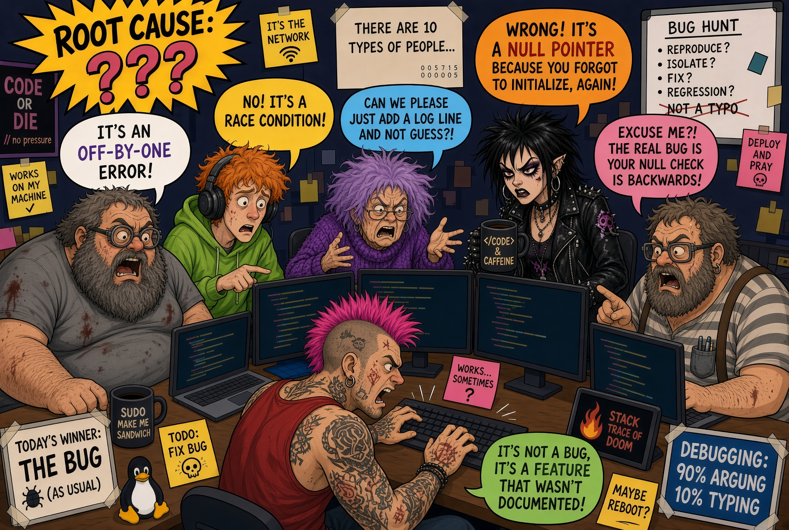

# hit-squad

That bunch of nerds locked in the special room that nobody dares disrupt. Give them a problem, then get out of their way!



A collection of agent skills, installable with the [skills.sh](https://skills.sh) CLI — works with opencode, Claude Code, and any other skills-compatible agent.

## Install

```bash
npx skills add <owner>/hit-squad          # hit-squad, all agents
npx skills add <owner>/hit-squad -g       # global install
npx skills add <owner>/hit-squad -s root-cause-cabal -y   # one skill, no prompts
```

## Skill: root-cause-cabal

Point it at an issue — a bug, regression, incident, flaky test, outage — and it runs a root-cause investigation as a cabal of deranged, manically obsessive engineer personas. Each member investigates from a conflicting lens (logs, git history, state invariants, integration boundaries, environment, dependencies), they argue with each other about whose reasoning is better, and an arbiter keeps the quarrel productive: evidence above rhetoric, trivial fights killed, every rival hypothesis either entombed with evidence or honestly reported. The cabal hands its winning analysis to an RCA author who writes the final document.

The derangement is flavor; the epistemics are strict — every claim cites an artifact.

**Use it:**

```
> find the root cause of the checkout API 500s under load since Tuesday
> why does test_invoice_reconcile fail 1-in-20? use the cabal with 4 investigators
> root-cause-cabal: reconcile job corrupts ledger rows --contrarian
```

**Options:**

| Option | Default | What it does |
|---|---|---|
| issue (required) | — | What to investigate. Point it at repos, logs, failing tests, incident windows. |
| size | 3 | Number of investigative personas (2–6). Each gets a different lens. |
| contrarian | off | Adds The Deranged Skeptic: an adversarial member who contests the finer details, asks the challenging questions, and never has the answers. Sits outside the size count. |

**What you get:**

- The root cause in 2–3 sentences, the mechanism in 3–5 steps, and a confidence level
- The rival hypotheses the cabal killed and the evidence that killed them
- Unsettled objections from the Skeptic (if seated) — as questions, never buried
- `RCA-<slug>.md` in your workspace: timeline, causal chain with citations, eliminated rivals, open questions, unknown list, and remediation proposals

The cabal investigates read-only and never edits your code unless you explicitly ask for a fix.

**Going deeper:** [SKILL.md](skills/root-cause-cabal/SKILL.md) has the full workflow; [references/](skills/root-cause-cabal/references/) has the persona roster, the arbiter protocol, and the RCA document template.
